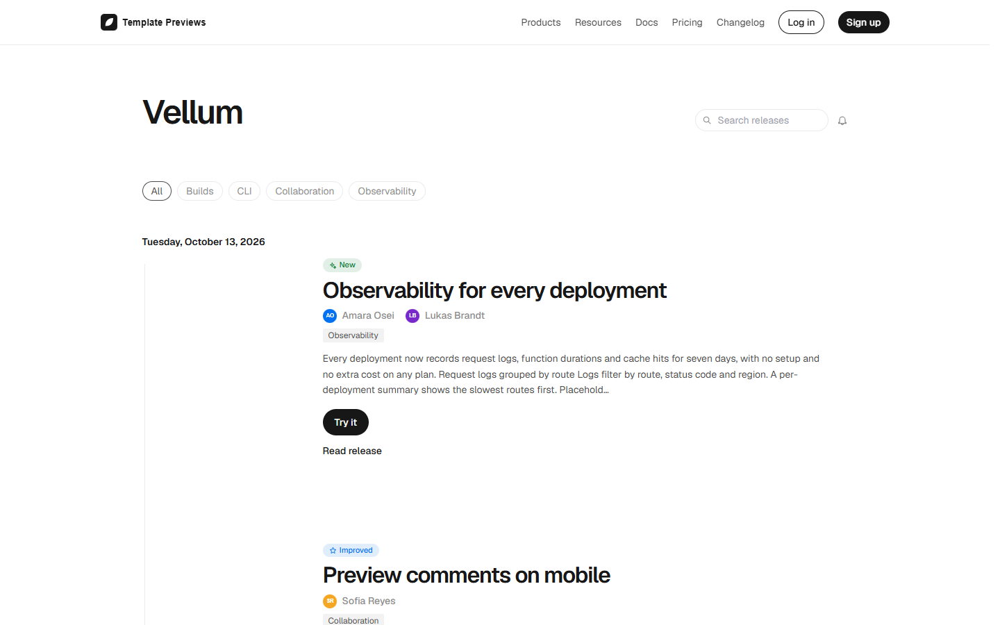
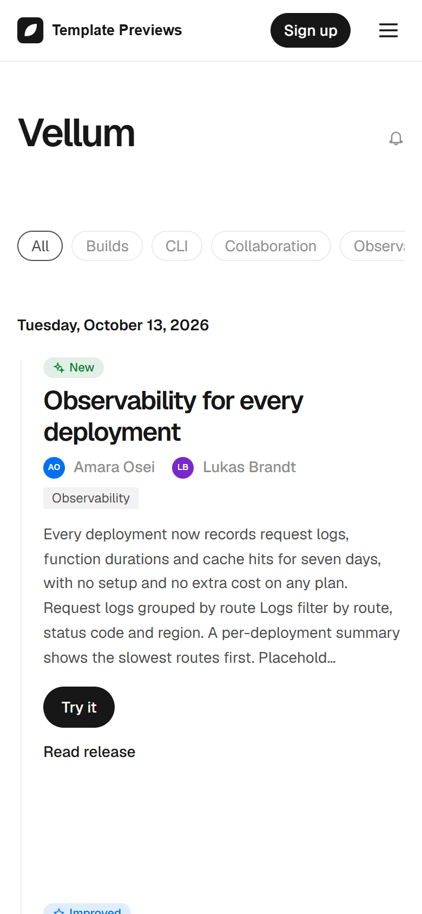

# Vellum

**An official Forumulate changelog template.** Modelled on: a frontend cloud platform’s changelog.

A light, airy changelog of summaries: each day once in a wide date gutter beside a hairline rail, big tight titles, the people who shipped it, tag pills and a round feed button — and a release page with its facts in a side column.

| Desktop | Phone |
| ------- | ----- |
|  |  |

## What it uses

- Index layout: gutter (260px, hairline rail, no dots), one date per day
- Summaries only, with a “Read release” link
- Authors as avatars and names on every release
- 32px titles with tight tracking
- Tag pills, search and a round subscribe icon on the title row
- Month archive with “Load more”
- Release page: side column with date, reading time and copy/share actions
- Light and dark palettes
- Zero custom CSS — every detail is a theme setting
- Type: Geist and Geist Mono — self-hosted (the font is mirrored onto our own CDN on apply; readers never fetch from a third party)
- Colour scheme: light (dark palette included)

## What applying it creates

- **The look** — `bundle.json`, a theme bundle: palette, type, header and footer, the changelog's look (`theme.changelog`) and the composed front page. Published to the space straight away.
- **The layout** — index preset `gutter` and its front-door options.
- **The release page's after-band** — `piecePage`: a subscribe box under every release.
- **Tags** — 4 tags with their labels and colours.
- **Authors** — 3 placeholder people in the space's author registry, credited on the releases they wrote (credited by name; no account is made).
- **5 sample releases** — short, neutral placeholder copy with the change types, channels and versions the look is built to show, so the space looks like the preview on day one:
  - Observability for every deployment (New)
  - Preview comments on mobile (Improved)
  - Build cache keyed by lockfile (Fixed)
  - Node.js 18 builds are deprecated (Deprecated, breaking, with upgrade notes)
  - Edge config in the command line (New, Beta)

Nobody is mailed about a sample: the releases are published without notifying subscribers or watchers.

## Placeholders

- **“Your Brand”** — everywhere the brand appears (header and footer copy, the wordmark, the sample copy) it becomes your organization’s name when the template is applied.
- **Pictures** — the mark, wordmark, covers and portraits in `assets/` are drawn placeholders. They are copied into your space’s asset library, so replacing one is an ordinary upload.
- **Links** — header, footer and front-page links point at your new space’s own address; “Try it” links point at `example.com`.
- **Change types** — the samples use the changelog's own options (New, Improved, Fixed, Deprecated, Retired, Security). Rename them to your words in Design → shape; `theme.changelog.typeBadge.tones` keys follow the new names.

## Files

- `template.json` — the manifest (`forumulate.space-template` v1): layout, release page, tags, authors, sample releases (with their `fields`). Schema: `packages/shared/src/official-templates.ts`.
- `bundle.json` — the theme bundle (`forumulate.theme-bundle`); also listed in the theme marketplace as `template-vellum`.
- `assets/` — the placeholder pictures.
